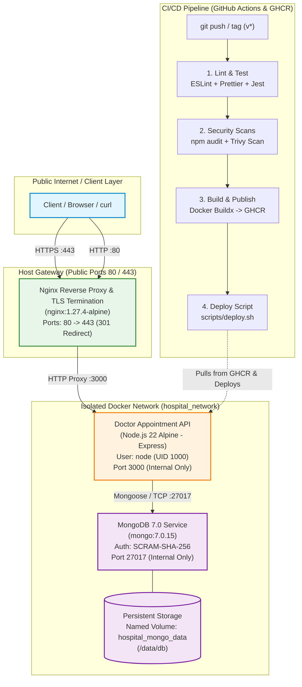
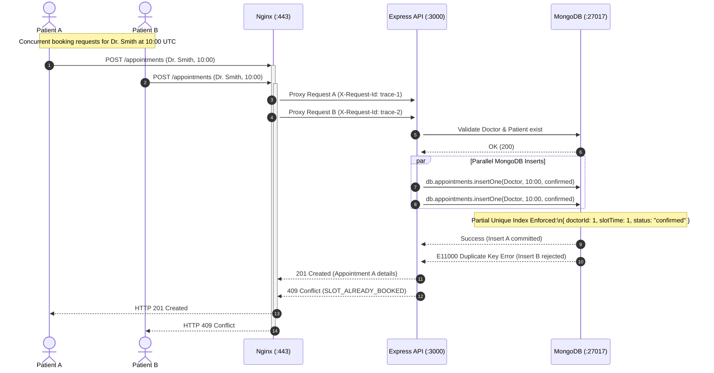
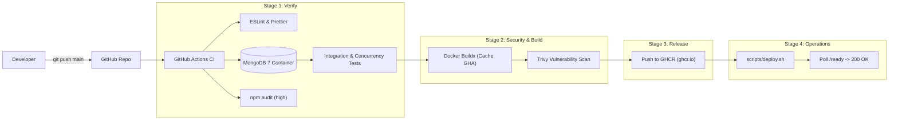

# Architecture Specification: Hospital Management Platform

This document describes the architectural topology, security boundaries, request life cycles, and deployment pipeline for the **Doctor Appointment & Hospital Management Platform**.

---

## 1. High-Level Architecture Overview

The system is deployed as a resilient, multi-tiered containerized architecture managed via Docker Compose and orchestrated via a zero-trust network model.



---

## 2. Component Breakdown

### 2.1 Edge & Ingress: Nginx Reverse Proxy

- **Role:** Single ingress point into the host.
- **Port Strategy:** Only Nginx binds to host interfaces:
  - Port `80`: Redirects all HTTP traffic to HTTPS via HTTP `301 Moved Permanently`.
  - Port `443`: Terminates TLS using modern ciphers (TLSv1.2 & TLSv1.3).
- **Security & Headers:**
  - Enforces `HSTS`, `X-Content-Type-Options: nosniff`, and `X-Frame-Options: SAMEORIGIN`.
  - Injects `X-Real-IP`, `X-Forwarded-For`, and `X-Forwarded-Proto`.
  - Propagates `X-Request-Id` for distributed end-to-end tracing.

### 2.2 Application Service: Express Doctor Appointment API

- **Runtime:** Node.js 22 Alpine (`node:22.14.0-alpine`), execution pinned to unprivileged user `node` (UID 1000).
- **Network Isolation:** Does not publish any ports to the host interface (`expose: 3000` only within the internal Docker bridge network).
- **Logging:** Structured JSON output powered by `pino` with automated correlation IDs (`X-Request-Id`).
- **Telemetry:** Prometheus scrape target exposed on `/metrics`.
- **Health System:**
  - Liveness (`GET /health`): Returns 200 indicating the Node event loop and HTTP server are responsive.
  - Readiness (`GET /ready`): Executes a dynamic database ping (`db.command({ ping: 1 })`). Returns `200 OK` when connected, or `503 Service Unavailable` during database outage or degradation.

### 2.3 Persistence Layer: MongoDB 7

- **Image:** `mongo:7.0.15` (pinned tag).
- **Access Control:** Full authentication enabled (`rootadmin` administrative user + least-privilege `hospital_app` user restricted to `readWrite` on `hospital_db`).
- **Storage:** Managed persistent Docker named volume `hospital_mongo_data` mapped to `/data/db`.
- **Index Architecture:** Built during application startup before accepting traffic:
  - **Partial Unique Index:**
    ```javascript
    { doctorId: 1, slotTime: 1 }
    // unique: true, partialFilterExpression: { status: "confirmed" }
    ```
    This guarantees zero double-bookings for active appointments, while allowing canceled appointments to release the slot for re-booking.

---

## 3. Data Flow & Concurrency Safe Booking

The sequence below illustrates concurrent booking requests arriving for the identical doctor and time slot:



---

## 4. CI/CD & Delivery Flow


